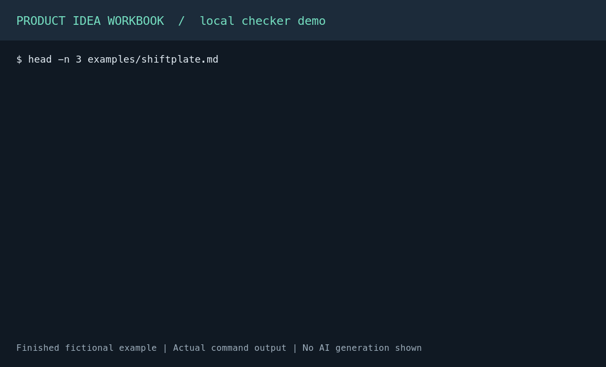

# Product Idea Workbook

**Find out whether your product idea is worth building—with evidence, competition, and a decision at every stage.**

[](https://github.com/Benjaminnnnnn/product-idea-workbook/stargazers)
[](LICENSE)
[](.claude-plugin/plugin.json)
[](#install-in-30-seconds)

## Why this exists

Generic AI product ideas sound convincing while skipping the hard parts: evidence that the problem is real, sizing that adds up, and the alternatives customers already use. These agent skills make those checks part of the workflow. Every number needs a source or an **ASSUMPTION** label; every stage ends with **PROCEED / PIVOT / STOP**. Stopping a weak idea is a useful outcome.

## Install in 30 seconds

**Claude Code** — run inside a Claude Code session:

```text
/plugin marketplace add Benjaminnnnnn/product-idea-workbook
/plugin install product-idea-workbook@product-idea
```

Follow the install prompts and reload if requested. See [Claude Code's plugin installation guide](https://code.claude.com/docs/en/discover-plugins).

**Codex, Cursor, Copilot, Gemini CLI, and other supported agents** — run in your terminal (requires Node.js and npm):

```bash
npx skills add Benjaminnnnnn/product-idea-workbook
```

Select your agent and all eight skills for the full workflow. You can also install an individual stage. See the [skills installer documentation](https://github.com/vercel-labs/skills).

**claude.ai** — download the individual skill ZIPs from the [latest GitHub Release](https://github.com/Benjaminnnnnn/product-idea-workbook/releases/latest). Enable code execution, then upload each ZIP under **Customize → Skills → + → Create skill → Upload a skill** and toggle it on. Upload all eight for the full pipeline. See [Claude's skill setup guide](https://support.claude.com/en/articles/12512180-use-skills-in-claude).

No release has been published yet. Until the first release, build the same ZIPs locally with Python 3:

```bash
git clone https://github.com/Benjaminnnnnn/product-idea-workbook.git
cd product-idea-workbook
python3 scripts/build.py
```

Upload the files in `dist/`, one ZIP per skill.

## Try it now

Paste one of these prompts into your agent after installing. In Claude Code, you can also invoke a skill directly with `/product-idea-workbook:new-product-idea` or `/product-idea-workbook:market-space`.

**“I have an idea.”**

```text
Use new-product-idea to evaluate a meal-planning app for US nurses working
12-hour shifts. Coach me through it, starting with whether the problem is real.
```

**“I have a competitor to beat.”**

```text
Use new-product-idea to evaluate an alternative to Calendly for independent
music teachers in the US. Run on autopilot. Test the customer problem before
proposing features, compare direct and indirect alternatives, and label assumptions.
```

**“I need to size a market.”**

```text
Use market-space to size the US market for scheduling software for independent
music teachers. The customer is a solo teacher managing recurring lessons;
the job is to keep the weekly lesson schedule full; the problem hypothesis
is that cancellations leave unpaid gaps. Count actors, cite sources, compare
alternatives, and pick a first segment. Leave revenue TAM pending until pricing.
```

**Coach** is the default and pauses after each stage. **Autopilot** runs without questions and labels missing evidence as assumptions. The full workflow writes `workbooks/<product-name>.md`, with a one-page brief, four stage sections, sources, and a next step. Enable web research for sourced numbers; unverified numbers must stay labeled assumptions.

## See an example

Read the [finished ShiftPlate workbook](examples/shiftplate.md) or browse [examples/](examples/). ShiftPlate is a fictional meal planner for shift-working nurses. It shows the expected depth, source trail, stage decisions, and assumptions still needing customer validation.



*A local checker run on the finished example, not a live AI generation. The same result is available as text by running:*

```bash
python3 skills/new-product-idea/scripts/check_workbook.py examples/shiftplate.md --complete
```

The checker catches structural problems such as missing sections, placeholders, and citations without references. An `OK` result does not establish customer demand or verify the truth of a source.

## The pipeline

```text
Problem Space ──▶ Market Space ──▶ Solution Space ──▶ Value Space ──▶ Idea Brief
 (is it real?)    (who, how many,    (what we build)    (why they'd     (1-page
                   who else wins?)                       switch + pay)   summary)
```

| Skill | What it does |
|---|---|
| [new-product-idea](skills/new-product-idea/SKILL.md) | Runs the full workflow in coach or autopilot mode and checks the workbook. |
| [customer-problem-space](skills/customer-problem-space/SKILL.md) | Defines the customer, job, measurable gap, root causes, and problem size. |
| [market-space](skills/market-space/SKILL.md) | Counts customers, chooses a segment, maps competitors, and finds a position to own. |
| [solution-space](skills/solution-space/SKILL.md) | Turns the problem and positioning into a concept, user flow, and requirements. |
| [customer-value-space](skills/customer-value-space/SKILL.md) | Compares benefits with switching costs, sets pricing, and fills in revenue TAM. |
| [product-idea-brief](skills/product-idea-brief/SKILL.md) | Summarizes the evidence, biggest risk, and GO / NO-GO decision on one page. |
| [market-research](skills/market-research/SKILL.md) | Finds and opens sources for numbers, or marks them as assumptions. |
| [stage-review](skills/stage-review/SKILL.md) | Challenges evidence, consistency, and traceability before a stage decision. |

## Contributing

Found a missing check or a vague output? [Open an issue](https://github.com/Benjaminnnnnn/product-idea-workbook/issues) with a small, non-confidential example, or send a focused PR. Skill requests are welcome too.

Read [AGENTS.md](AGENTS.md) for commit and release conventions. Edit the worked example in `examples/shiftplate.md`, then run `python3 scripts/build.py` to regenerate skill examples; never edit `skills/*/example.md` directly. Before committing, run:

```bash
python3 -m unittest discover -s tests
python3 scripts/build.py --check
```

See [steps.md](steps.md) for the roadmap and [CHANGELOG.md](CHANGELOG.md) for changes. If this helps you make a better product decision, star the repo so you can find it again.

## License

[MIT](LICENSE) © 2026 Benjamin Zhuang.
