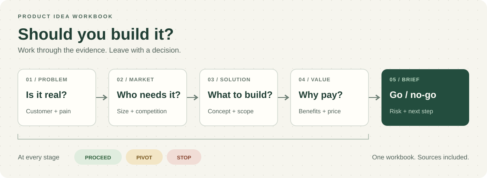

# Product Idea Workbook

Test a product idea before you build it. Agent skills for researching the problem, finding a market, and deciding whether to proceed.

[](#quick-start)
[](https://github.com/vercel-labs/skills)
[](LICENSE)

[](examples/shiftplate.md)

## Quick start

Choose your agent and install all nine skills.

### Claude.ai and Claude Desktop

Requires Pro, Max, Team, or Enterprise. In Desktop, open **Chat** or **Cowork** first.

1. Open **Customize → Plugins → Add → Add marketplace**.
2. Choose **Add from a repository** and paste `https://github.com/Benjaminnnnnn/product-idea-workbook`.
3. Find **product-idea-workbook** in **Discover** and click **Add**.

Install once for your Claude account to use it on web and Desktop. Team and Enterprise admins may restrict marketplaces. [Plugin guide](https://support.claude.com/en/articles/13837440-use-plugins-in-claude).

<details>
<summary>Free plan or manual skill upload</summary>

1. Download and extract the single all-skills ZIP from the [latest release](https://github.com/Benjaminnnnnn/product-idea-workbook/releases/latest).
2. Enable **Code execution and file creation** in **Settings → Capabilities**.
3. Claude.ai accepts one skill per upload: zip the skill folder you want to use, upload it under **Customize → Skills → + → Create skill → Upload a skill**, then enable it.

[Skill setup guide](https://support.claude.com/en/articles/12512180-use-skills-in-claude).

</details>

### Claude Code

Run these commands inside a Claude Code session:

```text
/plugin marketplace add Benjaminnnnnn/product-idea-workbook
/plugin install product-idea-workbook@product-idea
```

### Other agents

For Codex, Cursor, Copilot, Gemini CLI, or another [supported agent](https://github.com/vercel-labs/skills), run this in your terminal (requires Node.js and npm):

```bash
npx skills add Benjaminnnnnn/product-idea-workbook
```

Select your agent and all nine skills when prompted.

## Choose a mode

Paste either example into your agent, replacing the idea with yours.

**Autopilot (default)** runs without questions, labels assumptions, and still reviews and checks each stage.

```text
Use new-product-idea to evaluate a meal-planning app
for nurses in the US.
```

**Coach (optional)** asks for missing details and pauses after each stage for your input.

```text
Use new-product-idea in coach mode to evaluate a meal-planning app
for nurses in the US.
```

Switch anytime with “continue in coach mode” or “continue on autopilot.” In Claude Code, you can also invoke `/product-idea-workbook:new-product-idea` with your idea and optional mode.

## How it works

Your agent follows four stages: problem → market → solution → value. It reviews the evidence after each one, then writes a one-page brief with a GO / NO-GO decision.

- **Evidence:** research numbers with web access; label anything unverified `ASSUMPTION`.
- **Competition:** compare direct competitors, indirect alternatives, and doing nothing.
- **Decisions:** proceed, pivot, or stop at each stage. A weak idea can end early.

You get `workbooks/<product-name>.md` with the research, sources, biggest risk, and next step. The included checker catches missing sections and references; customer validation still needs real people.

Use `market-space` on its own to size a market or compare competitors. [Browse all nine skills →](skills/)

## See the result

[Read the ShiftPlate workbook →](examples/shiftplate.md), a fictional meal planner for shift-working nurses. It includes customer journeys, positioning maps, pricing, and assumptions to test. Its next step is a two-week food diary with 15 nurses.

## Contributing

[Report a vague output or missing check](https://github.com/Benjaminnnnnn/product-idea-workbook/issues), or send a focused PR. Follow [AGENTS.md](AGENTS.md) and run:

```bash
python3 -m unittest discover -s tests
python3 scripts/build.py --check
```

[MIT license](LICENSE) · [Changelog](CHANGELOG.md)
