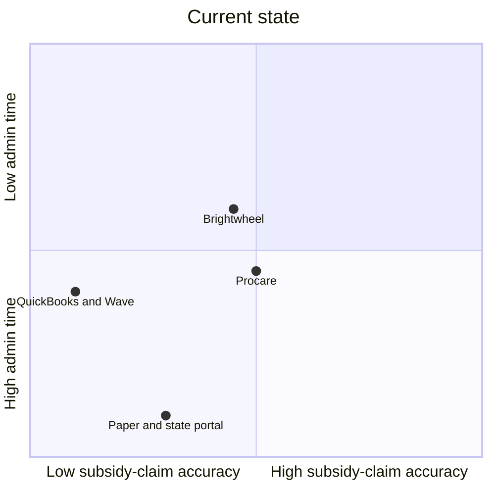
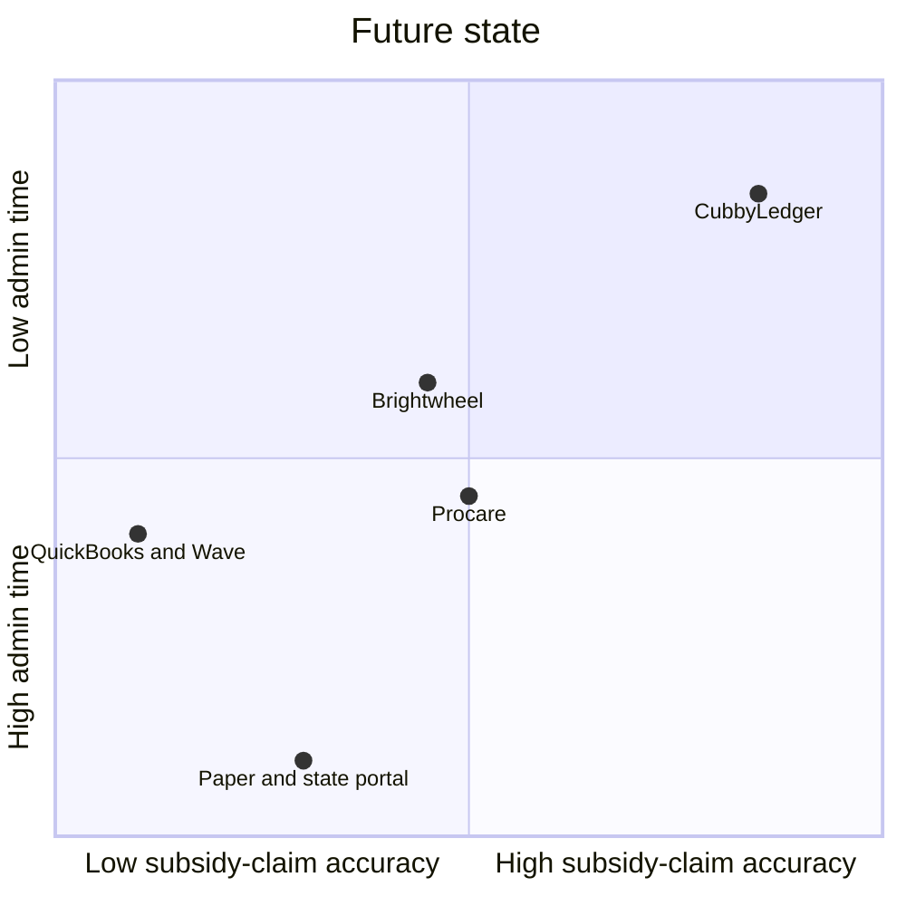
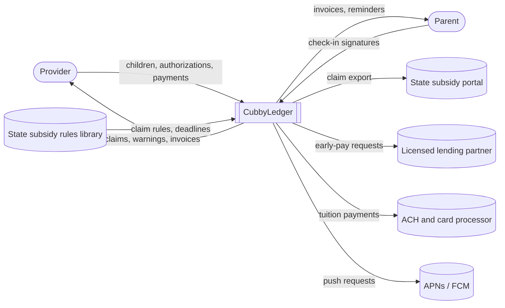

# CubbyLedger — Product Idea Workbook

*Fictional demo product, generated on autopilot · 2026-10-18. The network policy blocked every source page during this run, so each sourced number is labeled ASSUMPTION until someone opens the page listed in the appendix.*

## Product Idea Brief

| | |
|---|---|
| **Product** | CubbyLedger: turns daily check-ins into clean subsidy claims and tuition invoices for home-based child care |
| **Customer & job** | US listed home-based child care providers billing a state subsidy for at least one child need to get paid in full and on time for every child they care for |
| **Problem** | Subsidy claims are short-paid or rejected, and billing eats about 5 hours a week of unpaid time |
| **Problem size** | \$18.5M–\$74.0M per year in unpaid subsidy, plus about 6.4M hours of unpaid admin |
| **Market** | ~36,720 subsidy-billing home-based providers; TAM \$7.5M after the pricing pivot |
| **Focus segment** | Providers with 3 or more subsidy-paid children (16,524): the most subsidy revenue at risk |
| **Competition** | Direct: Brightwheel, Procare. Indirect: general invoicing tools. Do nothing: paper sign-in sheets and the state portal |
| **Position to own** | The low-cost billing assistant for one-person home programs that checks every subsidy claim against the state's rules before it's sent |
| **Solution** | Tap-in attendance, a state-rule claim checker, claim export, tuition invoices; MVP: FR-1 to FR-5 |
| **Value proposition** | For home-based providers with 3 or more subsidy children, CubbyLedger is a child care billing app that gets every claim paid in full the first time |
| **Pricing** | Free tier; Plus at \$19.99/month or \$199/year; optional 1% early-pay fee on approved claims |
| **Success metrics** | Subsidy short-paid or rejected: 8% → 2% of billed; billing admin: 5 h → 1.5 h per week; late tuition invoices: 1 in 5 → 1 in 20 |

**Top risks & assumptions to validate**
1. About 8% of billed subsidy is short-paid or rejected: test it by auditing 3 months of claims from 10 providers in 2 states (\$0, 3 weeks).
2. 45% of listed home-based providers bill a subsidy: test it with state subsidy provider lists in 3 states (\$0, 1 week).
3. Providers will pay \$199/year plus a 1% early-pay fee: test it with a fake-door pricing page shown to 200 providers (\$200 in ads, 2 weeks).

**Decision:** PIVOT: the problem and value are real, but a subscription alone gives a \$3.3M TAM, so the pricing now adds a 1% early-pay fee (TAM \$7.5M). Validate the early-pay demand before building it.

**Next step:** Audit 3 months of subsidy claims with 10 providers.

## 1. Customer Problem Space

### 1. Fertile Land
Back-office tools for home-based child care. **Why now:** the number of listed home-based providers keeps falling, from 91,200 in 2019 to 81,600 in 2024 (ASSUMPTION: OPRE NSECE figures, unverified), and states are changing how they pay subsidy providers after the 2024 federal rule, so billing rules are shifting under providers (ASSUMPTION: New America, unverified).

### 2. Customer
A US listed home-based child care provider (licensed, registered, or license-exempt but on a state list) who bills a state child care subsidy for at least one child.

### 3. Job To Be Done
Get paid in full and on time for every child I care for.

### 4. Outcomes
| Actual outcome | Desired outcome | Measurement method |
|---|---|---|
| Share of billed subsidy that is short-paid or rejected: 8% (ASSUMPTION) | 2% | (Subsidy billed − subsidy paid) ÷ subsidy billed, per provider per month |
| Time spent on attendance records, claims, and chasing payments: 5 h per week (ASSUMPTION) | 1.5 h per week | Weekly self-reported check-in, averaged across active providers |
| Private-pay tuition invoices paid more than 7 days late: 1 in 5 (ASSUMPTION) | 1 in 20 | Invoices paid > 7 days after the due date ÷ invoices issued, per provider per month |

### 5. Problem
**a. Gap**

6 percentage points of billed subsidy lost to short pays and rejections (8% → 2%), and 3.5 hours a week of avoidable admin (5 h → 1.5 h). This means there is a 6-point gap in getting paid in full and a 3.5-hour gap in weekly admin time.

**b. Causes**
1. Many states pay by attendance, so every absence, late sign-in, or missing signature reduces the payment.
2. Each state, and sometimes each county, has its own claim rules, forms, and deadlines.
3. Attendance is kept on paper sign-in sheets and re-typed into the state portal at the end of the month.
4. Payment arrives weeks after care is given, so errors are found long after they can be fixed.
5. The provider is also the teacher, cook, and cleaner, so billing happens late at night.

### 6. Customer Journey Map
| Stage | Doing | Thinking / feeling | Pain point | Opportunity |
|---|---|---|---|---|
| Enroll a child | Copies the subsidy authorization into a binder | "How many hours did they approve?" | Authorized hours and dates live on paper | Capture authorization limits once |
| Daily sign-in | Parents sign a paper sheet | "Did everyone sign out?" | Missing signatures void billable days | Tap-in check-in with a signature on the phone |
| Month end | Re-types attendance into the state portal | "Another Sunday night on this." | Re-typing causes errors | Pre-filled claim from the check-ins |
| Submit claim | Sends the claim before the deadline | "I hope this is right." | No check against the state's rules | Flag problems before sending |
| Wait for payment | Covers food and rent from savings | "When does the money come?" | Paid weeks after care | Show the expected payment date |
| Reconcile | Compares the payment with the claim | "Why is it \$140 short?" | Short pays are hard to trace | Line-by-line payment match |
| Chase tuition | Texts parents about late tuition | "I hate asking for money." | Awkward, manual reminders | Automatic invoices and reminders |

### 7. Use Cases
- Record daily check-in and check-out with a parent signature *(for: all subsidy-billing providers)*
- Check a monthly claim against the state's rules before submitting *(for: providers in attendance-paid states)*
- Track authorized hours and expiring authorizations *(for: providers with 3 or more subsidy children)*
- Match each subsidy payment to the claim and flag short pays *(for: all subsidy-billing providers)*
- Send private-pay tuition invoices and reminders *(for: providers with mixed subsidy and private-pay families)*
- Get paid early on an approved claim *(for: providers with 3 or more subsidy children)*

### 8. Problem Sizing
- **Per instance:** one monthly claim that is short-paid or rejected loses 6% of that month's subsidy billing (8% − 2%, ASSUMPTION).
- **Annualized per actor:** 1–4 subsidy children × \$700 per child per month (ASSUMPTION) × 12 = \$8,400–\$33,600 billed per year × 6% = **\$504–\$2,016 per provider per year**, plus 3.5 h × 50 weeks = 175 hours.
- **Total impact, annually:** 36,720 providers (see 2.1) × \$504–\$2,016 = **\$18.5M–\$74.0M per year** in unpaid subsidy, plus 36,720 × 175 h = about 6.4M hours of unpaid admin.
- **Assumptions:** the 8% short-pay rate (verify with a 3-month claim audit of 10 providers); \$700 per subsidy child per month (verify against 3 states' published rate tables); 1–4 subsidy children per provider (verify with state subsidy provider lists); 50 working weeks per year.

### 9. Problem Category
Subsidy billing leakage

### 10. Problem Statement
Home-based child care providers expect to be paid in full for the care they give. In reality, many states pay by attendance and pay weeks after care is given, with reimbursements arriving up to 60 days later (ASSUMPTION: New America, unverified), and every missing signature or rule mismatch cuts the payment. We estimate that 36,720 subsidy-billing home-based providers each lose \$504–\$2,016 a year to short-paid or rejected claims, or **\$18.5M–\$74.0M per year** in total, plus about 6.4M hours of unpaid admin. Therefore, a solution is needed to help home-based child care providers get paid in full and on time for every child they care for.

### Stage decision
**PROCEED**: payment by attendance and payment in arrears are documented policy problems, and the gap is worth \$18.5M or more a year even at the low end. The size rests on unverified numbers, so it is a named risk.

**Riskiest assumption:** that about 8% of billed subsidy is short-paid or rejected. Test it by auditing 3 months of claims from 10 providers in 2 states.

## 2. Market Space

### 1. Overall Market
**US listed home-based providers that bill a state subsidy: 36,720 (~36.7K)**

81,600 listed home-based providers in 2024 (ASSUMPTION: OPRE NSECE figure, unverified) × 45% bill a state subsidy for at least one child (ASSUMPTION: verify with state subsidy provider lists in 3 states) = 36,720.

### 2. Total Addressable Market (TAM)
**\$7.5M per year:** 16,524 focus-segment providers × \$451 per year (\$199 Plus subscription + \$252 early-pay fees; see 4.3).

### 3. Market Segmentation
| Segmentation variable | Segmentation values |
|---|---|
| Subsidy-paid children | 1–2, 3–5, 6 or more |
| State payment basis | Attendance-based, enrollment-based, mixed |
| Program size | Family home (≤ 6 children), large or group home (7–12 children) |

### 4. Target Market Profiles
| Segment name | Definition (numeric thresholds) | No. of actors |
|---|---|---|
| Light subsidy homes | 1–2 subsidy-paid children | 20,196 |
| Core subsidy homes | 3–5 subsidy-paid children | 11,016 |
| Group subsidy homes | 6 or more subsidy-paid children | 5,508 |

**Estimation reasoning:** 36,720 providers split 55% / 30% / 15% (ASSUMPTION: verify with state subsidy provider lists in 3 states). The three segments sum to the overall market.

**Why this segmentation:** the number of subsidy-paid children is **measurable** from state provider lists, and providers are **reachable** through state family child care associations and the subsidy agencies' provider newsletters. Each segment is **big enough** at 5,000 or more. The segments are **distinct**, because subsidy revenue at risk grows with each subsidy child. It also **changes what we'd build**: homes with 3 or more subsidy children need authorization tracking and payment matching, while light homes mainly need tuition invoices.

### 5. Competition
**Direct**

| Product | Company | Unique positioning |
|---|---|---|
| Brightwheel | Brightwheel | An all-in-one center and home child care app (check-in, parent messaging, billing); quote-based pricing, about \$50–\$150/month (ASSUMPTION: third-party estimates for centers, unverified) |
| Procare | Procare Solutions | Child care management software for programs of all sizes, from single sites to multi-site organizations; quote-based, reported from \$69/month (ASSUMPTION: competitor blog, unverified) |

**Indirect: general invoicing and bookkeeping tools**

*Why customers treat them as a substitute:* they send tuition invoices and record payments, which covers private-pay families, but they know nothing about subsidy rules.
- QuickBooks | Intuit: small-business bookkeeping and invoicing (ASSUMPTION: check current prices on quickbooks.intuit.com)
- Wave | Wave Financial: free invoicing with paid payment processing (ASSUMPTION: check current prices on waveapps.com)

**Do nothing / workaround:** paper sign-in sheets, re-typing attendance into the state portal at month end, and texting parents about late tuition.

### 6. Positioning Analysis
**a. Current State Positioning Map**

*Why these axes:* claim accuracy drives the short-pay outcome, and admin time drives the weekly-hours outcome (section 1.4).

**b. Future State Positioning Map**

**Gaps found:**
1. No tool checks a subsidy claim against the provider's state rules before it is sent.
2. No low-cost tool is built for a one-person home program; existing tools are priced and designed for centers first.
3. Providers wait weeks for subsidy payment with no way to get paid sooner.

**c. Position-to-Own**

The low-cost billing assistant for one-person home programs that checks every subsidy claim against the state's rules before it's sent.

### 7. Market Focus Decision
**Focus:** core and group subsidy homes, with 3 or more subsidy-paid children (11,016 + 5,508 = 16,524).

**Explanation:** these homes have the most subsidy revenue at risk (\$25,200 or more billed a year at 3 children), so the claim checker pays for itself fastest. They are reachable through the same associations and subsidy newsletters, and they already lose money to short pays, which signals willingness to pay.

### Stage decision
**PROCEED**: there's a clear gap (high claim accuracy at low admin time), and the focus segment is reachable. The focus segment is small at 16,524 providers, which stage 4 must account for.

**Riskiest assumption:** the 45% subsidy share and the 55 / 30 / 15 split by subsidy children.

## 3. Solution Space

### 1. Product Concept Outline
1. **Product name:** CubbyLedger
2. **Purpose:** Turn daily check-ins into clean subsidy claims and tuition invoices for home-based child care
3. **Product category:** Child care billing app
4. **Main attributes:**

   | Attribute | Positioning gap it fills (2.6) |
   |---|---|
   | State-rule claim checker | 1. Check each claim before it is sent |
   | Tap-in attendance with parent signature | 1. Clean records that hold up to the state's rules |
   | One-person pricing and setup | 2. Built and priced for a home program |
   | Early pay on approved claims | 3. Get paid sooner |

5. **Software deliverables:** Android app, iOS app, parent check-in web link
6. **Physical deliverables:** Not applicable
7. **Input/output methods:** touchscreen, on-screen signature, visual display, push notifications, CSV and PDF claim export
8. **Production infrastructure:** public cloud

### 2. User Views
**Primary platform:** Android

1. **Welcome:** provider taps "Set up my program" → system asks for the state and county
2. **Load state rules:** provider confirms the state → system loads that state's claim rules and deadlines
3. **Add children:** provider enters each child and their subsidy authorization (hours, dates, copay) → system stores the limits
4. **Daily check-in:** parent signs in and out on the provider's phone → system time-stamps the record
5. **Live warning:** a child is near their authorized hours → system flags it the same day
6. **Month-end claim:** provider opens "This month's claim" → system pre-fills it from check-ins and checks it against the state rules
7. **Fix and export:** provider fixes the flagged lines → system exports the claim in the state's format
8. **Payment match:** provider enters the payment received → system matches it to the claim line by line and lists short pays
9. **Tuition invoices:** provider sends private-pay invoices → system sends reminders when they're due

**First value moment:** step 6, when the first claim is pre-filled and checked; **time to value:** under 15 minutes of setup, then the first month end.

**Key screens**
```
┌──────────────────────────────────┐
│ October claim — 4 children       │
│ ✓ Ava    18 days   \$742.50      │
│ ⚠ Leo    missing sign-out 10/14  │
│ ✓ Maya   20 days   \$825.00      │
│ ⚠ Noah   over authorized hours   │
│ [ Fix 2 issues ]  [ Export ]     │
└──────────────────────────────────┘
```

### 3. Functional Requirements
| ID | The system shall… | Traces to | Priority | MVP |
|---|---|---|---|---|
| FR-1 | Record check-in and check-out times with a parent signature for each child | UC: daily check-in with signature | Must | ✓ |
| FR-2 | Store each child's subsidy authorization (hours, dates, copay) and warn before limits are exceeded | UC: track authorized hours | Must | ✓ |
| FR-3 | Pre-fill a monthly claim from attendance and check it against the provider's state rules | Gap: 1 | Must | ✓ |
| FR-4 | Export the claim in the state's required format (CSV or PDF) | UC: check a monthly claim | Must | ✓ |
| FR-5 | Match each payment received to the claim line by line and list short pays | UC: match payments and flag short pays | Must | ✓ |
| FR-6 | Send private-pay tuition invoices with automatic reminders | UC: tuition invoices and reminders | Should | |
| FR-7 | Advance payment on approved claims through a licensed lending partner | Gap: 3 | Should | |
| FR-8 | Submit claims directly to state portals where an API exists | Gap: 1 | Could | |
| FR-9 | Parent self check-in from their own phone by a one-time link | UC: daily check-in with signature | Could | |

### 4. Context View


### 5. Non-Functional Requirements
| Category | Requirement | Measurable target |
|---|---|---|
| Performance | Claim pre-fill and rule check are fast | p95 < 2 s for 12 children and 31 days |
| Availability | Check-in works at drop-off time | 99.9% monthly, 06:00–19:00 local |
| Security | Child and family data is encrypted in transit and at rest | TLS 1.2+, AES-256 at rest, MFA for providers |
| Privacy & compliance | CCDF rules (45 CFR Part 98) and each state's record-retention rules; CCPA/CPRA (California); PCI DSS through the processor; NACHA rules for ACH; early pay offered only through a licensed lending partner | Attendance records kept for each state's retention period (at least 3 years); deletion within 30 days of request after that |
| Accessibility | Usable with TalkBack, VoiceOver, large text, and Spanish | WCAG 2.2 AA; English and Spanish at launch |
| Scalability | Handles growth without re-architecture | 20K providers and 100K children |
| Offline use | Check-in works without a signal and syncs later | 100% of the day's check-ins captured offline |

### Stage decision
**PROCEED**: the MVP is buildable by a small team for 2 launch states, and it delivers the position to own.

**MVP cut:** FR-1 to FR-5 are in; FR-6 to FR-9 come after launch. Early pay (FR-7) waits for a lending partner.

## 4. Customer Value Space

### 1. Product Features and Benefits
| Feature | Benefit (customer's words) | Outcome improved (actual → expected) |
|---|---|---|
| State-rule claim checker | "My claim gets paid the first time." | Subsidy short-paid or rejected: 8% → 2% of billed |
| Tap-in attendance and pre-filled claims | "No more Sunday nights re-typing sign-in sheets." | Billing admin: 5 h → 1.5 h per week |
| Payment match | "I know exactly why a payment is short." | Subsidy short-paid or rejected: 8% → 2% of billed |
| Tuition invoices and reminders | "I don't have to ask parents for money." | Late tuition invoices: 1 in 5 → 1 in 20 |

### 2. Customer Value Proposition Strategy
**Primary strategy:** Better: compared with Brightwheel and Procare, it checks each subsidy claim against the state's rules before it's sent. It's also cheaper than both for a one-person home program.

**Value proposition:** For home-based providers with 3 or more subsidy children who need to get paid in full and on time, CubbyLedger is a child care billing app that gets every claim paid in full the first time. Unlike Brightwheel, it knows each state's subsidy rules and is priced for a home program.

### 3. Pricing Model
**Model:** freemium subscription plus an optional early-pay fee (after the pivot below)

| Plan | Price | Includes |
|---|---|---|
| Free | \$0 | Check-in and tuition invoices for up to 3 children; no claim checker |
| Plus | \$19.99/month or \$199/year | Claim checker, claim export, payment match, authorization warnings |
| Early pay | 1% of each approved claim | Approved claims paid within 2 business days through a lending partner |

| Alternative | Price (source, date) |
|---|---|
| Brightwheel | Quote-based; about \$50–\$150/month (ASSUMPTION: third-party estimates, 2026-10-18) |
| Procare | Quote-based; reported from \$69/month (ASSUMPTION: competitor blog, 2026-10-18) |
| QuickBooks or Wave | Free to paid tiers; no subsidy features (ASSUMPTION) |
| Do nothing | \$0, plus 5 h per week and 8% short pays (1.4) |

**Why this price:** \$199/year is about 13% of the low-end value recovered for a focus-segment provider (\$1,512 a year at 3 subsidy children: \$25,200 × 6%), so the provider keeps about 87% of it. It's priced below Brightwheel and Procare. The 1% early-pay fee is \$252 a year at \$25,200 billed, for cash that otherwise arrives weeks later.

### 4. Customer Cost Items
| Cost item | Type | Estimate | How we reduce it |
|---|---|---|---|
| Subscription | Money | \$199 per year | Free tier to try check-in first |
| Early-pay fee | Money | \$252–\$336 per year, if used | Optional; only on approved claims |
| Daily check-in | Time | 1 minute per child per day | Faster than a paper sheet |
| Setup | Learning | 15 minutes plus each authorization | State rules pre-loaded |
| Moving off paper | Switching | One month of running both | Claim export matches the paper totals |
| A rule-library error causes a short pay | Risk | Rare, but damages trust (ASSUMPTION) | Rule changes reviewed against each state's published updates |

### 5. Customer Value Proposition Evaluation
| Option | Value per actor/year | Total cost per actor/year | Net value |
|---|---|---|---|
| CubbyLedger | \$1,512–\$2,016 in recovered subsidy (3–4 children), plus ~175 h saved | \$451–\$535 (\$199 + early pay) | \$1,061–\$1,481 |
| Brightwheel | ~30% of that value, because claims aren't checked against state rules (ASSUMPTION): \$454–\$605 | \$600–\$1,800 (ASSUMPTION) | −\$1,346 to +\$5 |
| Do nothing | \$0 | \$0 | \$0 (baseline) |

**Verdict:** CubbyLedger leaves a focus-segment provider \$1,061–\$1,481 ahead each year, plus about 175 hours, and both alternatives net about \$0 or less. Without early pay, net value is higher (\$1,313–\$1,817), but the business is smaller.

**TAM (copied into 2.2):** subscription only: 16,524 × \$199 = \$3.3M. With early pay: 16,524 × (\$199 + \$252) = **\$7.5M**

### Stage decision
**PIVOT**: the provider clearly comes out ahead, but a subscription-only TAM of \$3.3M can't sustain a team. Change: add the optional 1% early-pay fee, which addresses gap 3 and raises the TAM to \$7.5M. The gate passes with the change, but \$7.5M is still a small-team business, so the next expansion is enrollment-paid states and small centers.

**Riskiest assumption:** that providers will pay \$199/year and use early pay at 1%. Test it with a fake-door pricing page shown to 200 providers.

## Appendix — References

The network policy blocked these pages during this run, so none of them was opened. Every number below is labeled ASSUMPTION in the workbook until someone opens the page and finds it.

- Office of Planning, Research & Evaluation (OPRE), ACF. *Home-Based Child Care and Early Education Providers: Counts and Characteristics* (NSECE). https://acf.gov/opre/report/home-based-child-care-and-early-education-providers-counts-and-characteristics. Found by web search 2026-10-18; not opened. Reported: 81,600 listed home-based providers in 2024, 91,200 in 2019.
- New America. *Big Changes in Federally Supported Child Care Payments Are Coming in 2025.* https://www.newamerica.org/insights/big-changes-in-federally-supported-child-care-payments-are-coming-in-2025/. Found by web search 2026-10-18; not opened. Reported: subsidy reimbursements arriving up to 60 days after care.
- Child Care Aware of America. *Child Care at a Standstill.* https://www.childcareaware.org/thechildcarestandstill. Found by web search 2026-10-18; not opened. Reported: licensed family child care homes fell from 107,041 (2019) to 94,227 (2023) in 39 states.
- Saasworthy. *Brightwheel pricing.* https://www.saasworthy.com/product/brightwheel/pricing. Found by web search 2026-10-18; not opened. Third-party pricing estimates.
- MyKidReports. *Procare Alternative & Pricing.* https://mykidreports.com/procare-alternative-and-pricing. Found by web search 2026-10-18; not opened. Competitor blog; reported from \$69/month.
