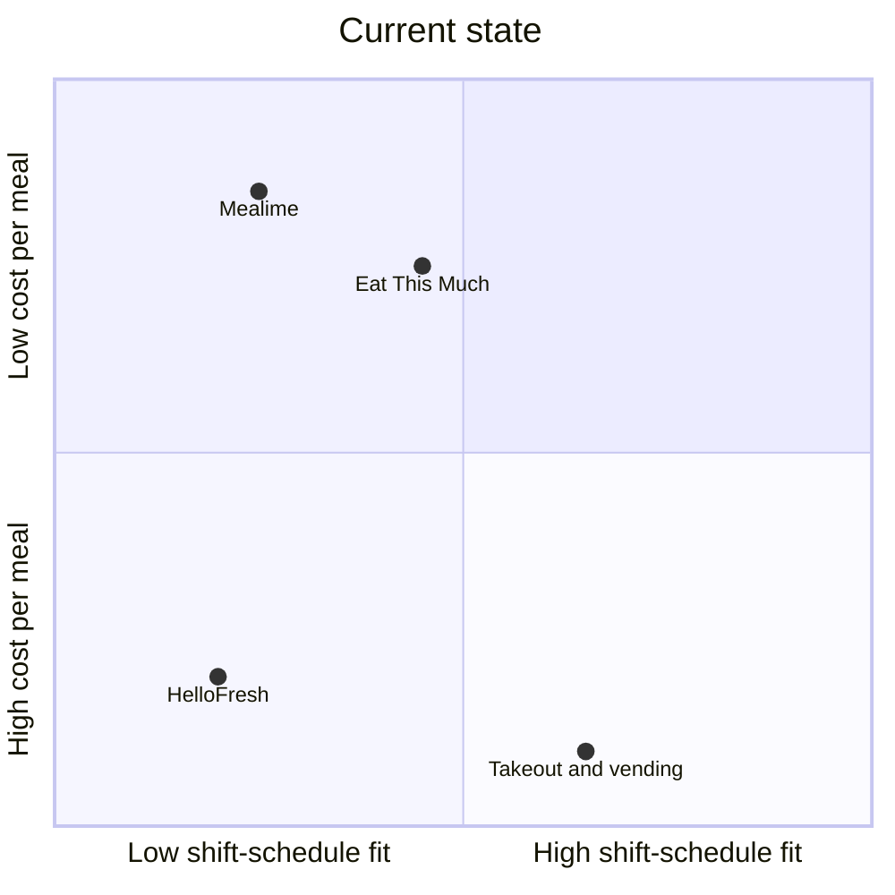
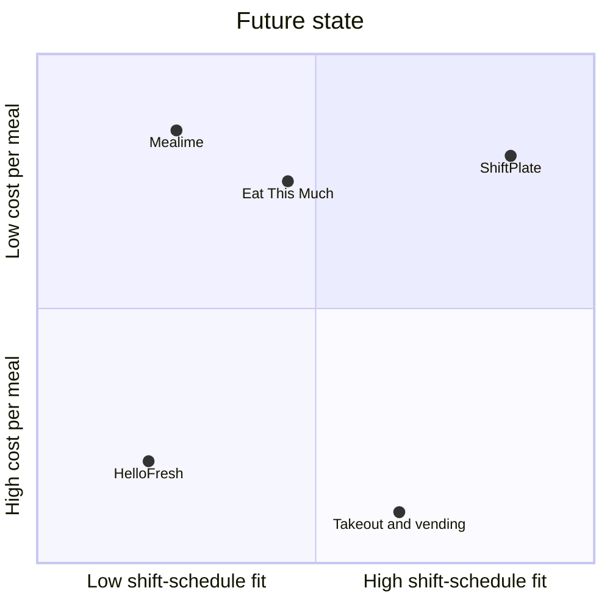
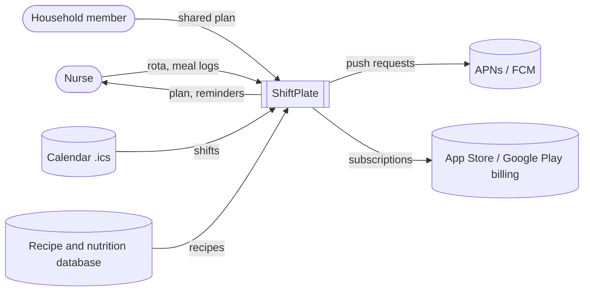

# ShiftPlate — Product Idea Workbook

*Fictional demo product, created to show the expected depth and evidence standard · 2026-10-16*

## Product Idea Brief

| | |
|---|---|
| **Product** | ShiftPlate: plans, shops, and batch-preps meals around a nurse's shift rota |
| **Customer & job** | US hospital nurses on 12-hour or rotating shifts need to eat a proper meal during and after a 12-hour shift |
| **Problem** | Shift nurses skip or replace main meals on most shift days and pay for takeout and vending instead |
| **Problem size** | \$1.1B–\$2.4B per year in avoidable shift-day food spend |
| **Market** | ~1.64M US hospital RNs on 12-hour or rotating shifts; TAM \$43.2M |
| **Focus segment** | Night 12-hour and rotating-shift nurses (~900K): worst meal disruption, schedule fit matters most |
| **Competition** | Direct: Mealime (shutting down), Eat This Much. Indirect: meal kits. Do nothing: vending, cafeteria, takeout |
| **Position to own** | A meal planner for shift-working nurses that times and preps meals around their rota, for less than takeout |
| **Solution** | Rota-aware meal timing, shift boxes, batch-prep plan, takeout-savings tracker; MVP: FR-1 to FR-5 |
| **Value proposition** | For night and rotating-shift nurses who need to eat properly at work, ShiftPlate is a meal planning app that has the next shift's meal ready in their bag |
| **Pricing** | Freemium; Plus at \$5.99/month or \$47.99/year |
| **Success metrics** | Shift days with a skipped main meal: 3 → 1 of 4; shift-day food spend: \$15 → \$5; planning and prep time: 3 h → 1 h per week |

**Top risks & assumptions to validate**
1. US nurses skip or replace a main meal on about 3 of 4 shift days: test it with a 2-week food diary from 15 nurses at 2 hospitals (\$0, 3 weeks).
2. Night and rotating nurses are about 55% of the 12-hour workforce: test it with a 100-response survey in nursing communities (\$0, 1 week).
3. Nurses will pay \$47.99/year: test it with a fake-door pricing page shown to 200 nurses (\$200 in ads, 2 weeks).

**Decision:** GO: every stage passed its gate, and the riskiest assumptions are cheap to test before building.

**Next step:** Run the 2-week food diary with 15 nurses.

## 1. Customer Problem Space

### 1. Fertile Land
Meal planning for people with irregular work schedules. **Why now:** Mealime, a popular free meal planner with 54K App Store ratings, shuts down on 21 October 2026 (Mealime, 2026), and its users are looking for a replacement.

### 2. Customer
A US hospital staff nurse (RN) working 12-hour or rotating shifts.

### 3. Job To Be Done
Eat a proper meal during and after a 12-hour shift.

### 4. Outcomes
| Actual outcome | Desired outcome | Measurement method |
|---|---|---|
| Shift days with a skipped or snack-replaced main meal: 3 of 4 (ASSUMPTION, based on 78.2% of night-shift nurses having irregular meal timing (Samhat et al., 2020)) | 1 of 4 | Shift days logged with a skipped or snack-replaced main meal ÷ shift days logged, per user per week |
| Takeout and vending spend on shift days: \$15 per shift day (ASSUMPTION) | \$5 per shift day | Shift-day food spend logged in the app ÷ shift days, per user per week |
| Time spent planning and prepping shift meals: 3 h per week (ASSUMPTION) | 1 h per week | Weekly self-reported check-in, averaged across active users |

### 5. Problem
**a. Gap**

2 shift days per week with a skipped main meal (3 → 1 of 4), and \$10 of avoidable food spend per shift day (\$15 → \$5). This means there is a 2-day gap in eating properly at work and a \$10 gap in daily food spend.

**b. Causes**
1. Meal breaks are unpredictable, because patient care interrupts or cancels them.
2. Night shifts have few food options: cafeterias are closed, leaving vending machines.
3. After a night shift, nurses are too exhausted to cook.
4. Rotas rotate, so a fixed weekly meal plan breaks within days.
5. General meal planners assume three meals at fixed clock times.

### 6. Customer Journey Map
| Stage | Doing | Thinking / feeling | Pain point | Opportunity |
|---|---|---|---|---|
| Get the rota | Checks next month's shifts | "Three nights in a row again." | The rota arrives late and changes | Import the rota and replan automatically |
| Plan the week | Tries to plan around shifts | "I'll figure it out later." | Planners ignore shift timing | Meals timed to the shift, not the clock |
| Shop | Shops on a day off | "What do I even need?" | No list that matches the shifts | One shopping list per rota stretch |
| Prep | Cooks if there's energy | "Too tired, I'll buy something." | No energy after nights | One batch session that covers the whole stretch |
| Shift day | Grabs vending or takeout | "No break yet. Chips again." | A meal isn't ready to grab | A labeled shift box, ready in the fridge |
| Recover | Sleeps, eats whatever is there | "I'm starving and wrecked." | No plan for after nights | Recovery meals that are ready on waking |

### 7. Use Cases
- Plan meals around a rotating schedule *(for: rotating-shift nurses)*
- Grab-and-go shift box *(for: 12-hour day nurses)*
- Night-shift fueling plan *(for: night nurses)*
- Post-night recovery meal *(for: night nurses)*
- One batch-prep session per rota stretch *(for: all shift nurses)*
- Shared meal plan with a household *(for: nurses with partners or kids)*

### 8. Problem Sizing
- **Per instance:** one shift day of takeout or vending instead of a planned meal = \$15 − \$5 = \$10 of extra spend (ASSUMPTION).
- **Annualized per actor:** 2–3 such days per week × 48 working weeks × \$7–\$10 = \$672–\$1,440 per nurse per year.
- **Total impact, annually:** 1,635,669 nurses (see 2.1) × \$672–\$1,440 = **\$1.1B–\$2.4B per year** in avoidable food spend, before any health costs.
- **Assumptions:** \$15 takeout and \$5 home-meal cost per shift day (verify with a 15-nurse food diary). 2–3 affected days per week, based on a Lebanese sample (Samhat et al., 2020); US rates are unverified. 48 working weeks per year.

### 9. Problem Category
Shift-work nutrition gap

### 10. Problem Statement
Nurses are expected to eat proper meals to stay alert through 12-hour shifts. In reality, 78.2% of nurses in a night-shift study had irregular meal timing, and 56% reported gaining weight since starting work (Samhat et al., 2020). We estimate that 1,635,669 US hospital nurses on 12-hour or rotating shifts each lose \$672–\$1,440 a year to takeout and vending on shift days, or **\$1.1B–\$2.4B per year** in total. Therefore, a solution is needed to help shift-working nurses eat a proper meal during and after a 12-hour shift.

### Stage decision
**PROCEED**: the problem is documented in published research and is worth \$1.1B or more a year, even at the low end of the estimate.

**Riskiest assumption:** how many shift days US nurses actually skip a main meal. Test it with a 2-week food diary from 15 nurses at 2 hospitals.

## 2. Market Space

### 1. Overall Market
**US hospital RNs on 12-hour or rotating shifts: 1,635,669 (~1.64M)**

3,465,400 RN jobs (2025) × 59% employed in hospitals (BLS, 2026) = 2,044,586 hospital RNs × 80% on 12-hour or rotating shifts (ASSUMPTION: verify with an ANA or AACN staffing survey) = 1,635,669.

### 2. Total Addressable Market (TAM)
**\$43.2M per year:** 899,618 focus-segment nurses × \$47.99 per year (see 4.3).

### 3. Market Segmentation
| Segmentation variable | Segmentation values |
|---|---|
| Shift pattern | Day 12-hour, night 12-hour, rotating |
| Household | Single, with partner, with kids |
| Cooking habit | Cooks from scratch, assembles, doesn't cook |

### 4. Target Market Profiles
| Segment name | Definition (numeric thresholds) | No. of actors |
|---|---|---|
| Day 12-hour nurses | All shifts ≥ 12 h, starting 06:00–09:00 | 736,051 |
| Night 12-hour nurses | All shifts ≥ 12 h, starting 18:00–21:00 | 408,917 |
| Rotating-shift nurses | ≥ 1 switch between day and night shifts per month | 490,701 |

**Estimation reasoning:** 1,635,669 nurses split 45% / 25% / 30% (ASSUMPTION: verify with a 100-response survey). The three segments sum to the overall market.

**Why this segmentation:** shift pattern is **measurable** from rota data, and nurses are **reachable** through hospital unit groups and nursing communities. Each segment is **big enough** at 400K or more. The segments are **distinct**, because night and rotating nurses lose the most meals. It also **changes what we'd build**: meal timing, recovery meals, and prep cadence all depend on shift pattern.

### 5. Competition
**Direct**

| Product | Company | Unique positioning |
|---|---|---|
| Mealime | Mealime Meal Plans Inc. | A free, simple recipe planner (Pro \$2.99/month, now free), **shutting down on 21 Oct 2026** (Mealime, 2026) |
| Eat This Much | Eat This Much Inc. | Automatic meal plans built to calorie and macro targets, budget, and schedule; \$8.99/month or \$59.99/year (Eat This Much, 2026) |

**Indirect: meal kits**

*Why customers treat them as a substitute:* a meal kit removes planning and shopping, which are the steps nurses skip when they're tired.
- HelloFresh | HelloFresh SE: about \$10–\$13 per serving plus weekly shipping (ASSUMPTION: check current prices on hellofresh.com)

**Do nothing / workaround:** vending machines and the cafeteria on shift, takeout or delivery after shift, or skipping the meal entirely.

### 6. Positioning Analysis
**a. Current State Positioning Map**

*Why these axes:* schedule fit drives the skipped-meal outcome, and cost per meal drives the spend outcome (section 1.4).

**b. Future State Positioning Map**

**Gaps found:**
1. No planner is built around shift patterns, with meals timed to the shift rather than the clock.
2. No low-cost option gives you a meal that's ready to grab on a shift day.
3. Mealime's shutdown leaves users of a low-cost planner without one.

**c. Position-to-Own**

A meal planner for shift-working nurses that times and preps meals around their rota, for less than takeout.

### 7. Market Focus Decision
**Focus:** night 12-hour and rotating-shift nurses (408,917 + 490,701 = 899,618).

**Explanation:** this is where meals are most disrupted (the night-shift findings in 1.10) and where schedule fit matters most. These nurses are reachable through the same unit groups and communities, and they already spend money on takeout, which signals willingness to pay.

### Stage decision
**PROCEED**: there's a clear gap (high schedule fit at low cost), and the focus segment is large and reachable.

**Riskiest assumption:** the 45 / 25 / 30 shift-pattern split.

## 3. Solution Space

### 1. Product Concept Outline
1. **Product name:** ShiftPlate
2. **Purpose:** Plan, shop for, and batch-prep meals around a nurse's shift rota
3. **Product category:** Meal planning app
4. **Main attributes:**

   | Attribute | Positioning gap it fills (2.6) |
   |---|---|
   | Rota-aware meal timing | 1. Meals timed to the shift, not the clock |
   | Shift boxes from one batch-prep session | 2. A ready-to-grab, low-cost meal on shift days |
   | Takeout-savings tracker | 2. Low cost, made visible |
   | Free import of recipes from a URL | 3. A home for Mealime users |

5. **Software deliverables:** iOS app, Android app
6. **Physical deliverables:** Not applicable
7. **Input/output methods:** touchscreen, visual display, push notifications, calendar file (.ics) import
8. **Production infrastructure:** public cloud

### 2. User Views
**Primary platform:** iOS

1. **Welcome:** user taps "Plan around my shifts" → system starts onboarding
2. **Import rota:** user imports a .ics file or taps in their shifts → system detects the shift pattern
3. **Household & diet:** user sets how many people they're cooking for and any diet needs → system filters recipes
4. **Week plan:** user sees meals placed at shift start, break, and end → system generates the plan timed to the rota
5. **Shopping list:** user approves the list → system consolidates ingredients for the whole stretch
6. **Prep session:** user follows a 60-minute batch plan → system labels shift boxes by day
7. **Shift reminder:** user gets "Pack box 2" before the shift → system sends a push notification
8. **Log meal:** user taps eaten / skipped / bought instead → system records the outcome
9. **Weekly summary:** user sees skipped meals and money saved → system compares with the baseline

**First value moment:** step 4; **time to value:** under 5 minutes.

**Key screens**
```
┌──────────────────────────────┐
│ This stretch: 3 nights       │
│ Mon 19:00  Box 1  Chili bowl │
│ Tue 19:00  Box 2  Curry      │
│ Wed 19:00  Box 3  Pasta bake │
│ Thu 08:30  Recovery: omelet  │
│ [ Approve shopping list ]    │
└──────────────────────────────┘
```

### 3. Functional Requirements
| ID | The system shall… | Traces to | Priority | MVP |
|---|---|---|---|---|
| FR-1 | Import a shift schedule from a .ics file or manual entry | UC: plan around a rotating schedule | Must | ✓ |
| FR-2 | Generate a meal plan timed to each shift's start, break, and end | Gap: 1 | Must | ✓ |
| FR-3 | Consolidate one shopping list per rota stretch | UC: batch-prep session | Must | ✓ |
| FR-4 | Produce a batch-prep plan that outputs labeled shift boxes | Gap: 2 | Must | ✓ |
| FR-5 | Log each planned meal as eaten, skipped, or bought instead, in one tap | Outcome measurement (1.4) | Must | ✓ |
| FR-6 | Show a weekly summary of skipped meals and spend saved compared with takeout | Gap: 2 | Should | |
| FR-7 | Suggest recovery meals after a night shift | UC: post-night recovery meal | Should | |
| FR-8 | Import recipes from a URL | Gap: 3 | Should | |
| FR-9 | Share the plan with household members | UC: shared meal plan | Could | |

### 4. Context View


### 5. Non-Functional Requirements
| Category | Requirement | Measurable target |
|---|---|---|
| Performance | Plan generation is fast | p95 < 3 s |
| Availability | The service is up | 99.5% monthly |
| Security | Data is encrypted in transit and at rest; no patient data is ever stored | TLS 1.2+, AES-256 at rest |
| Privacy & compliance | Food logs are treated as health data: CCPA/CPRA (California) and the FTC Health Breach Notification Rule | Data deletion within 30 days of request |
| Accessibility | Usable with VoiceOver, TalkBack, and large text | WCAG 2.2 AA |
| Scalability | Handles growth without re-architecture | 100K monthly active users |
| Offline use | The plan and shift boxes can be viewed without a signal (hospital basements) | 100% of the current stretch cached |

### Stage decision
**PROCEED**: the MVP is buildable by a small team and delivers the position to own.

**MVP cut:** FR-1 to FR-5 are in; FR-6 to FR-9 come after launch.

## 4. Customer Value Space

### 1. Product Features and Benefits
| Feature | Benefit (customer's words) | Outcome improved (actual → expected) |
|---|---|---|
| Rota-aware meal timing | "I know what I'm eating on every shift." | Skipped-meal shift days: 3 → 1 of 4 |
| Shift boxes | "Dinner's already in my bag." | Shift-day food spend: \$15 → \$5 |
| Batch-prep plan | "One prep session covers my whole stretch." | Planning and prep time: 3 h → 1 h per week |
| Takeout-savings tracker | "I can see what I saved." | Makes all three outcomes visible |

### 2. Customer Value Proposition Strategy
**Primary strategy:** Easier: compared with Eat This Much and Mealime, it fits a shift rota with no manual replanning. It's also cheaper than takeout and meal kits.

**Value proposition:** For night and rotating-shift nurses who need to eat a proper meal during and after a 12-hour shift, ShiftPlate is a meal planning app that has the next shift's meal ready in their bag. Unlike general meal planners, it plans around the rota, not the clock.

### 3. Pricing Model
**Model:** freemium

| Plan | Price | Includes |
|---|---|---|
| Free | \$0 | One week plan; no shift boxes |
| Plus | \$5.99/month or \$47.99/year | Rota import, shift boxes, batch-prep plans, savings tracker |

| Alternative | Price (source, date) |
|---|---|
| Mealime Pro | \$2.99/month, now free until shutdown on 21 Oct 2026 (Mealime, 2026) |
| Eat This Much | \$8.99/month or \$59.99/year (Eat This Much, 2026) |
| Meal kits | About \$10–\$13 per serving plus shipping (ASSUMPTION) |
| Takeout and vending | About \$15 per shift day (ASSUMPTION, 1.8) |

**Why this price:** \$47.99/year is about 7% of the low-end value created (\$672 per year, 1.8), so the nurse keeps more than 90% of it. It's priced between Mealime and Eat This Much.

### 4. Customer Cost Items
| Cost item | Type | Estimate | How we reduce it |
|---|---|---|---|
| Subscription | Money | \$47.99 per year | Free tier to try first |
| Prep session | Time | 1 h per week | One batch plan per stretch |
| Setup | Learning | 5 minutes | Rota import and plan in under 5 minutes |
| Moving from Mealime | Switching | Re-saving favorite recipes | Free import from a URL |
| A last-minute shift swap breaks the plan | Risk | 1–2 swaps per month (ASSUMPTION) | One-tap reshuffle |

### 5. Customer Value Proposition Evaluation
| Option | Value per actor/year | Total cost per actor/year | Net value |
|---|---|---|---|
| ShiftPlate | \$672–\$1,440 in avoided spend, plus ~100 h saved | \$47.99 | \$624–\$1,392 |
| Eat This Much | ~30% of that value, because plans aren't shift-timed (ASSUMPTION): \$202–\$432 | \$59.99 | \$142–\$372 |
| Meal kits | \$672–\$1,440 in avoided takeout | ~\$1,392 above groceries (ASSUMPTION: \$11/serving vs. \$5, 144 servings, ~\$11/week shipping) | −\$720 to +\$48 |
| Do nothing | \$0 | \$0 | \$0 (baseline) |

**Verdict:** ShiftPlate leaves the nurse \$624–\$1,392 ahead each year, about 4× the best alternative, and it saves about 100 hours.

**TAM (copied into 2.2):** 899,618 × \$47.99 = **\$43.2M**

### Stage decision
**PROCEED**: the nurse comes out clearly ahead at a price that supports a small team.

**Riskiest assumption:** willingness to pay \$47.99/year. Test it with a fake-door pricing page shown to 200 nurses.

## Appendix — References

- U.S. Bureau of Labor Statistics (BLS) (2026). *Occupational Outlook Handbook: Registered Nurses.* https://www.bls.gov/ooh/healthcare/registered-nurses.htm. Accessed 2026-10-16.
- Samhat et al. (2020). *Relationship between night shift work, eating habits and BMI among nurses in Lebanon.* BMC Nursing. https://pmc.ncbi.nlm.nih.gov/articles/PMC7158014/. Accessed 2026-10-16.
- Mealime Meal Plans Inc. (2026). *Mealime Meal Plans & Recipes*, App Store listing. https://apps.apple.com/us/app/id1079999103. Accessed 2026-10-16.
- Eat This Much Inc. (2026). *Eat This Much – Meal Planner*, App Store listing. https://apps.apple.com/us/app/eat-this-much-meal-planner/id981637806. Accessed 2026-10-16.
