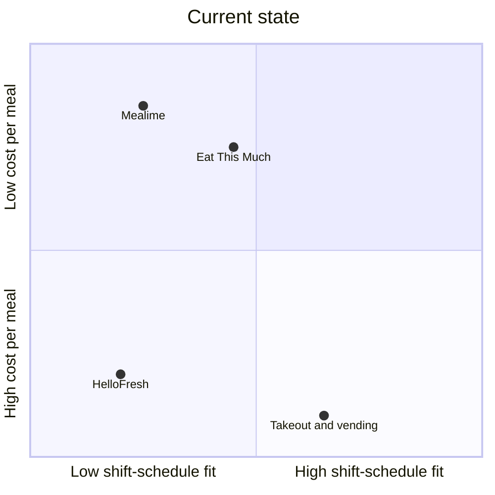
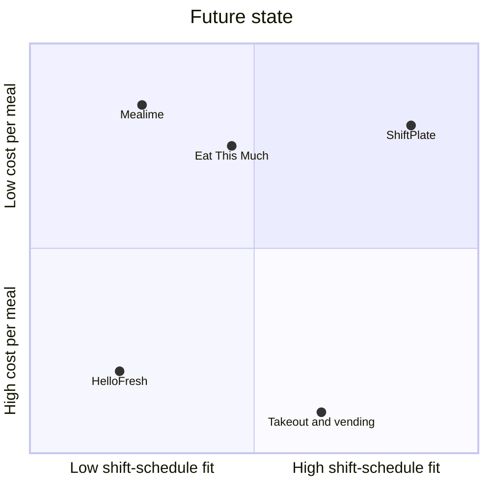

<!-- Generated from examples/shiftplate.md by scripts/build.py. Edit that file, then run: python3 scripts/build.py -->
# Worked example: ShiftPlate (fictional product)

This shows the depth and evidence standard to match. Don't copy its content or numbers; research the user's own product.

## 2. Market Space

### 1. Overall Market
**US hospital RNs on 12-hour or rotating shifts: 1,635,669 (~1.64M)**

3,465,400 RN jobs (2025) × 59% employed in hospitals (BLS, 2026) = 2,044,586 hospital RNs × 80% on 12-hour or rotating shifts (ASSUMPTION: verify with an ANA or AACN staffing survey) = 1,635,669.

### 2. Total Addressable Market (TAM)
**\$43.2M per year:** 899,618 focus-segment nurses × \$47.99 per year (see 4.3).

### 3. Market Segmentation
| Segmentation variable | Segmentation values |
|---|---|
| Shift pattern | Day 12-hour, night 12-hour, rotating |
| Household | Single, with partner, with kids |
| Cooking habit | Cooks from scratch, assembles, doesn't cook |

### 4. Target Market Profiles
| Segment name | Definition (numeric thresholds) | No. of actors |
|---|---|---|
| Day 12-hour nurses | All shifts ≥ 12 h, starting 06:00–09:00 | 736,051 |
| Night 12-hour nurses | All shifts ≥ 12 h, starting 18:00–21:00 | 408,917 |
| Rotating-shift nurses | ≥ 1 switch between day and night shifts per month | 490,701 |

**Estimation reasoning:** 1,635,669 nurses split 45% / 25% / 30% (ASSUMPTION: verify with a 100-response survey). The three segments sum to the overall market.

**Why this segmentation:** shift pattern is **measurable** from rota data, and nurses are **reachable** through hospital unit groups and nursing communities. Each segment is **big enough** at 400K or more. The segments are **distinct**, because night and rotating nurses lose the most meals. It also **changes what we'd build**: meal timing, recovery meals, and prep cadence all depend on shift pattern.

### 5. Competition
**Direct**

| Product | Company | Unique positioning |
|---|---|---|
| Mealime | Mealime Meal Plans Inc. | A free, simple recipe planner (Pro \$2.99/month, now free), **shutting down on 21 Oct 2026** (Mealime, 2026) |
| Eat This Much | Eat This Much Inc. | Automatic meal plans built to calorie and macro targets, budget, and schedule; \$8.99/month or \$59.99/year (Eat This Much, 2026) |

**Indirect: meal kits**

*Why customers treat them as a substitute:* a meal kit removes planning and shopping, which are the steps nurses skip when they're tired.
- HelloFresh | HelloFresh SE: about \$10–\$13 per serving plus weekly shipping (ASSUMPTION: check current prices on hellofresh.com)

**Do nothing / workaround:** vending machines and the cafeteria on shift, takeout or delivery after shift, or skipping the meal entirely.

### 6. Positioning Analysis
**a. Current State Positioning Map**

*Why these axes:* schedule fit drives the skipped-meal outcome, and cost per meal drives the spend outcome (section 1.4).

**b. Future State Positioning Map**

**Gaps found:**
1. No planner is built around shift patterns, with meals timed to the shift rather than the clock.
2. No low-cost option gives you a meal that's ready to grab on a shift day.
3. Mealime's shutdown leaves users of a low-cost planner without one.

**c. Position-to-Own**

A meal planner for shift-working nurses that times and preps meals around their rota, for less than takeout.

### 7. Market Focus Decision
**Focus:** night 12-hour and rotating-shift nurses (408,917 + 490,701 = 899,618).

**Explanation:** this is where meals are most disrupted (the night-shift findings in 1.10) and where schedule fit matters most. These nurses are reachable through the same unit groups and communities, and they already spend money on takeout, which signals willingness to pay.

### Stage decision
**PROCEED**: there's a clear gap (high schedule fit at low cost), and the focus segment is large and reachable.

**Riskiest assumption:** the 45 / 25 / 30 shift-pattern split.

## Appendix — References

- U.S. Bureau of Labor Statistics (BLS) (2026). *Occupational Outlook Handbook: Registered Nurses.* https://www.bls.gov/ooh/healthcare/registered-nurses.htm. Accessed 2026-10-16.
- Samhat et al. (2020). *Relationship between night shift work, eating habits and BMI among nurses in Lebanon.* BMC Nursing. https://pmc.ncbi.nlm.nih.gov/articles/PMC7158014/. Accessed 2026-10-16.
- Mealime Meal Plans Inc. (2026). *Mealime Meal Plans & Recipes*, App Store listing. https://apps.apple.com/us/app/id1079999103. Accessed 2026-10-16.
- Eat This Much Inc. (2026). *Eat This Much – Meal Planner*, App Store listing. https://apps.apple.com/us/app/eat-this-much-meal-planner/id981637806. Accessed 2026-10-16.
