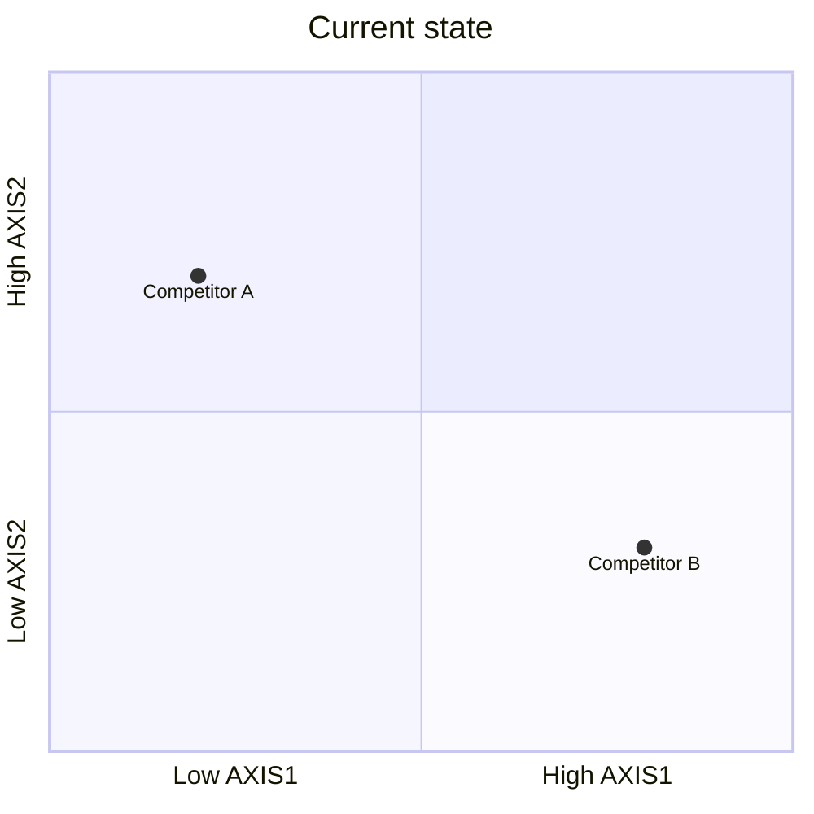
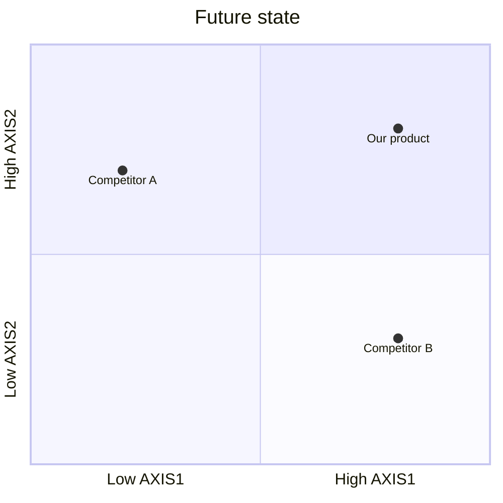

## 2. Market Space

### 1. Overall Market
**[Actor population]: [count]**

[Estimate chain: sourced number × factor = count (sources)]

### 2. Total Addressable Market (TAM)
*Pending pricing; this is filled in during Customer Value Space.*

### 3. Market Segmentation
| Segmentation variable | Segmentation values |
|---|---|
| [variable] | [value 1], [value 2], [value 3] |
| [...] | [...] |

### 4. Target Market Profiles
| Segment name | Definition (numeric thresholds) | No. of actors |
|---|---|---|
| [name] | [e.g. variable between X and Y] | [count] |

**Estimation reasoning:** [how each count was derived, with sources]

**Why this segmentation:** [measurable, reachable, big enough, distinct, changes what you'd build]

### 5. Competition
**Direct**

| Product | Company | Unique positioning |
|---|---|---|
| [product] | [company] | [one sentence, as they'd say it] |

**Indirect: [category]**

*Why customers treat it as a substitute:* [...]
- [Product] | [Company]

**Do nothing / workaround:** [what customers do today without a product]

### 6. Positioning Analysis
**a. Current State Positioning Map**

*Why these axes:* [how they tie to the section 1 outcomes]

**b. Future State Positioning Map**

**Gaps found:**
1. [gap no competitor fills]
2. [...]

**c. Position-to-Own**

[One sentence: a (category) for (focus segment) that (key difference).]

### 7. Market Focus Decision
**Focus:** [segment(s)]

**Explanation:** [size, how easy they are to reach, fit with the position, willingness to pay]

### Stage decision
**[PROCEED | PIVOT | STOP]**: [one sentence on why]
