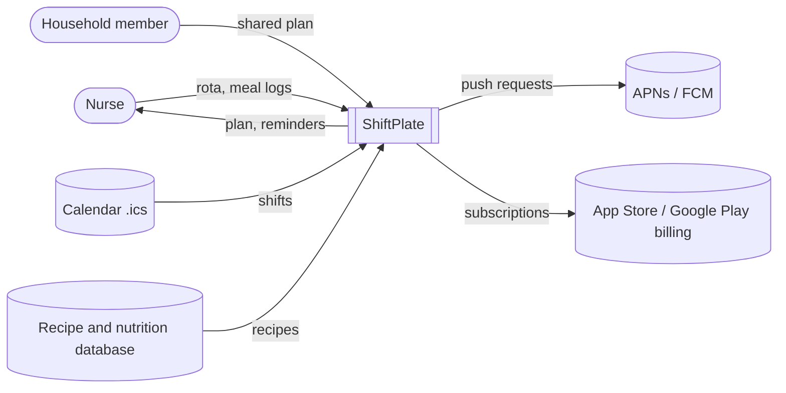

<!-- Generated from examples/shiftplate.md by scripts/build.py. Edit that file, then run: python3 scripts/build.py -->
# Worked example: ShiftPlate (fictional product)

This shows the depth and evidence standard to match. Don't copy its content or numbers; research the user's own product.

## 3. Solution Space

### 1. Product Concept Outline
1. **Product name:** ShiftPlate
2. **Purpose:** Plan, shop for, and batch-prep meals around a nurse's shift rota
3. **Product category:** Meal planning app
4. **Main attributes:**

   | Attribute | Positioning gap it fills (2.6) |
   |---|---|
   | Rota-aware meal timing | 1. Meals timed to the shift, not the clock |
   | Shift boxes from one batch-prep session | 2. A ready-to-grab, low-cost meal on shift days |
   | Takeout-savings tracker | 2. Low cost, made visible |
   | Free import of recipes from a URL | 3. A home for Mealime users |

5. **Software deliverables:** iOS app, Android app
6. **Physical deliverables:** Not applicable
7. **Input/output methods:** touchscreen, visual display, push notifications, calendar file (.ics) import
8. **Production infrastructure:** public cloud

### 2. User Views
**Primary platform:** iOS

1. **Welcome:** user taps "Plan around my shifts" → system starts onboarding
2. **Import rota:** user imports a .ics file or taps in their shifts → system detects the shift pattern
3. **Household & diet:** user sets how many people they're cooking for and any diet needs → system filters recipes
4. **Week plan:** user sees meals placed at shift start, break, and end → system generates the plan timed to the rota
5. **Shopping list:** user approves the list → system consolidates ingredients for the whole stretch
6. **Prep session:** user follows a 60-minute batch plan → system labels shift boxes by day
7. **Shift reminder:** user gets "Pack box 2" before the shift → system sends a push notification
8. **Log meal:** user taps eaten / skipped / bought instead → system records the outcome
9. **Weekly summary:** user sees skipped meals and money saved → system compares with the baseline

**First value moment:** step 4; **time to value:** under 5 minutes.

**Key screens**
```
┌──────────────────────────────┐
│ This stretch: 3 nights       │
│ Mon 19:00  Box 1  Chili bowl │
│ Tue 19:00  Box 2  Curry      │
│ Wed 19:00  Box 3  Pasta bake │
│ Thu 08:30  Recovery: omelet  │
│ [ Approve shopping list ]    │
└──────────────────────────────┘
```

### 3. Functional Requirements
| ID | The system shall… | Traces to | Priority | MVP |
|---|---|---|---|---|
| FR-1 | Import a shift schedule from a .ics file or manual entry | UC: plan around a rotating schedule | Must | ✓ |
| FR-2 | Generate a meal plan timed to each shift's start, break, and end | Gap: 1 | Must | ✓ |
| FR-3 | Consolidate one shopping list per rota stretch | UC: batch-prep session | Must | ✓ |
| FR-4 | Produce a batch-prep plan that outputs labeled shift boxes | Gap: 2 | Must | ✓ |
| FR-5 | Log each planned meal as eaten, skipped, or bought instead, in one tap | Outcome measurement (1.4) | Must | ✓ |
| FR-6 | Show a weekly summary of skipped meals and spend saved compared with takeout | Gap: 2 | Should | |
| FR-7 | Suggest recovery meals after a night shift | UC: post-night recovery meal | Should | |
| FR-8 | Import recipes from a URL | Gap: 3 | Should | |
| FR-9 | Share the plan with household members | UC: shared meal plan | Could | |

### 4. Context View


### 5. Non-Functional Requirements
| Category | Requirement | Measurable target |
|---|---|---|
| Performance | Plan generation is fast | p95 < 3 s |
| Availability | The service is up | 99.5% monthly |
| Security | Data is encrypted in transit and at rest; no patient data is ever stored | TLS 1.2+, AES-256 at rest |
| Privacy & compliance | Food logs are treated as health data: CCPA/CPRA (California) and the FTC Health Breach Notification Rule | Data deletion within 30 days of request |
| Accessibility | Usable with VoiceOver, TalkBack, and large text | WCAG 2.2 AA |
| Scalability | Handles growth without re-architecture | 100K monthly active users |
| Offline use | The plan and shift boxes can be viewed without a signal (hospital basements) | 100% of the current stretch cached |

### Stage decision
**PROCEED**: the MVP is buildable by a small team and delivers the position to own.

**MVP cut:** FR-1 to FR-5 are in; FR-6 to FR-9 come after launch.

## Appendix — References

- U.S. Bureau of Labor Statistics (BLS) (2026). *Occupational Outlook Handbook: Registered Nurses.* https://www.bls.gov/ooh/healthcare/registered-nurses.htm. Accessed 2026-10-16.
- Samhat et al. (2020). *Relationship between night shift work, eating habits and BMI among nurses in Lebanon.* BMC Nursing. https://pmc.ncbi.nlm.nih.gov/articles/PMC7158014/. Accessed 2026-10-16.
- Mealime Meal Plans Inc. (2026). *Mealime Meal Plans & Recipes*, App Store listing. https://apps.apple.com/us/app/id1079999103. Accessed 2026-10-16.
- Eat This Much Inc. (2026). *Eat This Much – Meal Planner*, App Store listing. https://apps.apple.com/us/app/eat-this-much-meal-planner/id981637806. Accessed 2026-10-16.
