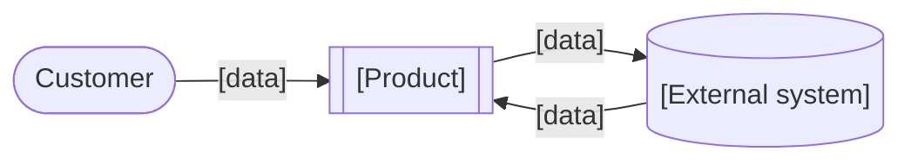

## 3. Solution Space

### 1. Product Concept Outline
1. **Product name:** [name]
2. **Purpose:** [one line]
3. **Product category:** [the category customers compare it in]
4. **Main attributes:**

   | Attribute | Positioning gap it fills (2.6) |
   |---|---|
   | [attribute] | [gap] |

5. **Software deliverables:** [web app, mobile app, API, ...]
6. **Physical deliverables:** [or Not applicable]
7. **Input/output methods:** [keyboard, touch, voice, camera, screen, ...]
8. **Production infrastructure:** [public cloud, private cloud, on-device, ...]

### 2. User Views
**Primary platform:** [platform]

1. **[Screen]:** [user does] → [system does]
2. [...]

**First value moment:** [step #]; **time to value:** [minutes]

**Key screens**
```
┌─────────────────────────┐
│ [Screen name]           │
│ [main element]          │
│ [primary action button] │
└─────────────────────────┘
```

### 3. Functional Requirements
| ID | The system shall… | Traces to | Priority | MVP |
|---|---|---|---|---|
| FR-1 | [...] | UC: [use case] / Gap: [gap] | Must | ✓ |

### 4. Context View


### 5. Non-Functional Requirements
| Category | Requirement | Measurable target |
|---|---|---|
| Performance | [...] | [e.g. p95 < 300 ms] |
| Availability | [...] | [e.g. 99.9% monthly] |
| Security | [...] | [...] |
| Privacy & compliance | [named regulations] | [...] |
| Accessibility | [...] | [e.g. WCAG 2.2 AA] |
| Scalability | [...] | [e.g. N concurrent users] |

### Stage decision
**[PROCEED | PIVOT | STOP]**: [one sentence on why]

**MVP cut:** [what's in, and what's deferred]
